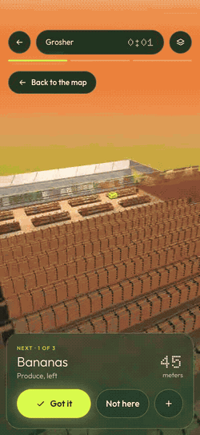

# Grosher

[](https://github.com/atishaypahadiya/Grosher/actions/workflows/ci.yml)

**[Read the project write-up](https://grosher.pages.dev/project/)** · [Open the app](https://grosher.pages.dev)

A shopping list in, the shortest walk through the store out: every item placed on its shelf, the route
re-solved each time you check one off, and every stop opening at eye level when you get there.

<p align="center">
  
</p>
<p align="center"><sub>The app as built: Produce, Got it, then Bulk. Recorded from the production build by <code>apps/web/scripts/capture-closeup.mjs</code>.</sub></p>

<p>
  
  
  
</p>
<p><sub>List, trip and checkout for one 14-item list (<code>apps/web/scripts/capture-project.mjs</code>, 20 Oct 2026). The design boards these started from are in <a href="design/boards/">design/boards/</a>; <a href="DESIGN.md">DESIGN.md</a> is the visual contract.</sub></p>

## What it does

### The list and the resolver

- **Type, paste or hold to speak.** Voice uses the Web Speech API: release to stop, and each pause becomes an
  item. Lists save, the usual trip for today's weekday is offered when the list is empty, and every trip goes
  into a history.
- **Every line is placed on a shelf, in seven layers.** In order: an exact catalog name or brand, your own
  memory of where you found it, a shelf category that names it ("atta", "tp"), a fuzzy match for typos
  (trigram Dice and Damerau–Levenshtein, threshold .72), a near spelling of a category, the language model,
  and finally a question for you ("Needs a place · Tell me where"). Every answer is checked against the map
  before it is used, so a stale location never reaches the solver.
- **A 47,612-item catalog.** It is built from the Instacart 2017 product list (44,531 rows, used under
  non-commercial terms; see `packages/stores/data/instacart/README.md`), 3,051 rows generated by a local
  model, and 30 hand-kept rows. A reconcile pass checks it shelf by shelf. The index is built in a Web Worker
  and cached in IndexedDB.
- **A local model for the rest.** `qwen3:8b` runs in Ollama on my Mac and picks one of the store's shelf
  categories, or none. One call covers the whole list, with strict JSON out. It is reached through a Cloudflare
  Worker, Tailscale Funnel and a token gate. No key ships in the app, and a test builds the bundle and searches
  it to make sure.
- **Honest about guesses.** Every placement carries a confidence: confirmed (≥ .8), likely (.5–.8) or guess
  (< .5). A model's answer starts in the guess band and shows in amber as "probably A4 · cereal". Got it moves
  a placement 30% of the way to certain, Not here takes .3 off, and anything unconfirmed for 90 days decays.
- **It learns the store.** A shelf you confirmed beats the catalog for that item. What you typed comes back as
  a suggestion ("yogurt" → "Chobani greek yogurt?"). Three misses in one aisle, or a quarter of a trip, flag
  the store as possibly reset and open that aisle in the editor.

### The route

- **Exact up to 13 stops.** `packages/core` (no dependencies) runs Dijkstra over a graph of corridors in metres,
  then Held–Karp over the stops, the candidate shelves of multi-location items and the checkout lanes. Above 13
  stops it runs 2-opt and Or-opt from three starts, with delta evaluation.
- **The constraints a person applies anyway.** They are penalties in metres, so they trade against distance
  instead of overriding it:
  - cold *and* hot last (chilled, frozen, the rotisserie and the hot bar), taken from the shelf's storage;
  - heavy early (by the shelf: cases of water, gallon jugs, big rice bags), so it goes in the cart first;
  - fragile late;
  - produce before the fragile things;
  - bulky (paper towels, chips) rides under the cart and costs nothing.
- **Re-solved at every check-off.** Got it, Not here and adding an item re-plan the remaining stops from the
  shelf you are standing at. An item the map cannot place is left out of the route and asked about at checkout.

### The store: Grosher

The app opens **Grosher**, our own designed Whole Foods-style market (85 × 70 m, spec in
[design/store-grosher.md](design/store-grosher.md)). It has produce under a skylight, bulk, ten centre aisles,
beer and wine, service counters and dairy on the east wall, frozen, a food hall, pharmacy and body care. That
comes to 325 shelf categories the way the signs read, 123 fixtures and eight staffed lanes plus express and
self-checkout. Four hero lists ship with it. A synthetic Walmart-style Supercenter (30 aisles, 298 categories)
is kept for the tests and as the reference taxonomy that survey mode matches Walmart signs against.

### On the trip

- **A 3D map of the store.** It frames the current leg, lights the exact bay and shelf of the next item, and
  shows cards for the next stop and the two after it, with chips on the edge for stops off screen.
- **Every stop at eye level.** When a stop becomes next, the camera comes down to the aisle and walks you to
  the shelf.
  - **Bulk** and **Produce** are hero zones, drawn from recipes with a procedural shelf kit: clay walls,
    gravity bins with grain at real size, burlap sacks and a stone chakki in Bulk; crates under a skylight, its
    wet wall and juice line in Produce.
  - The other 304 shelves get **standard close-ups** generated from the store data.
  - The next close-up is prepared while you are at the current stop, so it opens without a wait, and only
    one zone's textures are on the GPU at a time.
- **The off-list guard.** When you clearly drift off the route, a small card says "Nothing on your list here.
  Chips is 18 m ahead." with **Back on route** · I'm grabbing something.
  - It works from your steps (the phone's accelerometer) against the leg's length, with nothing more precise:
    there is no indoor positioning.
  - Arriving at the stop and staying there gets "Can't find Chips?" instead.
  - It never speaks in the first minute, during a close-up's arrival, in a queue, or while you wait at a
    counter.
  - Off · Gentle · Strict are in Settings. Motion data stays on the phone and only this trip's counts are
    kept.
  - `?demo=walk` plays it on a desk.
- **Checkout.** A share card shows the time, the metres walked and the saving against walking the list in
  order, plus "1 detour · off-route 1 min" when the guard spoke. A "Make the map better" list asks about
  what was skipped or never placed.

### Mapping a real store

- **One walk, in survey mode** (`#/survey` on the phone). Calibrate once by walking 10 m. Then, per aisle:
  Sign photo → Start → walk → End. Steps come from the accelerometer and directions from the compass; on the 8
  held-out synthetic walks, the step detector counts 156 of 160 steps. The aisle signs are read in the
  background by a vision model (`qwen2.5vl:7b`) and matched to shelf categories. "Build draft map" gives aisles
  at their lengths and spacing, with the signs' categories on them.
- **The editor** (`#/edit`, desktop) fixes the draft. It has a floor-plan underlay, corridors, doors, shelf
  blocks, locations, categories, textures, a confidence view, and Validate. "Write to package" writes it into
  `packages/stores/<storeId>`. The step-by-step guide is in `CLAUDE.md`, "How to map a new store".

### Offline, and never a blank screen

It is a PWA that installs to the home screen. After one visit the app, the map, the catalog and its index are
on the phone, and a trip needs no network. Saved state is versioned and validated, and a bad value is set aside
rather than read. Navigations are network-first, so a deploy reaches an installed app on its next open. An
inline boot guard shows an error plate with Reload and Reset (which exports your lists first) instead of a blank
page.

## Numbers

All measured on 20 Oct 2026 on this repo unless a CI run is named. Each one says how it was measured.

**Route vs walking the list as written**, Grosher's four hero lists (`packages/stores/test/grosher.test.ts`
against its snapshot `test/fixtures/grosher-hero-routes.json`; walking distance only, every item placed
offline, exact by Held–Karp):

| list | items | in order | Grosher | saved |
| --- | ---: | ---: | ---: | ---: |
| Weeknight dal-chawal | 10 | 440 m | 315 m | 28% |
| Weekly staples | 11 | 513 m | 359 m | 30% |
| Friday night in | 9 | 523 m | 289 m | 45% |
| Pharmacy run | 5 | 331 m | 256 m | 22% |

**Random lists** (`npm run bench -- --store grosher`: 30 random lists per size from 30 everyday items,
walking distance only, solve times on an M4 Pro):

| stops | solver | list order | Grosher | saved | saved p10–p90 | solve p50 | solve max |
| ---: | --- | ---: | ---: | ---: | ---: | ---: | ---: |
| 5 | Held–Karp | 339 m | 252 m | 25% | 9–40% | 0.0 ms | 0.2 ms |
| 8 | Held–Karp | 472 m | 305 m | 35% | 24–42% | 0.1 ms | 0.1 ms |
| 10 | Held–Karp | 577 m | 343 m | 41% | 28–49% | 0.4 ms | 1.2 ms |
| 13 | Held–Karp | 704 m | 391 m | 44% | 36–51% | 4.5 ms | 4.9 ms |
| 18 | heuristic | 977 m | 511 m | 48% | 44–54% | 4.1 ms | 9.1 ms |
| 25 | heuristic | 1,270 m | 614 m | 52% | 50–55% | 8.5 ms | 9.5 ms |
| 30 | heuristic | 1,532 m | 665 m | 57% | 53–59% | 18.1 ms | 19.8 ms |

**Item resolution** (`npm run eval:everyday -w @grosher/stores -- --store grosher`, scored at aisle level):

| set | without the model | with qwen3:8b |
| --- | ---: | ---: |
| 150 everyday items, written blind (food, brands, household, pharmacy, Indian staples, misspellings) | 149 / 150 (99%) | 149 / 150 |
| the same set on the demo Supercenter | 147 / 150 (98%) | – |
| 33 things Walmart grocery had no shelf for (beer and wine, bulk, cookware, flowers, the food hall; not blind) | 29 / 33 | 32 / 33 |

The one miss on Grosher is "salmon fillet", which lands on frozen fillets rather than the seafood counter.
The two tuned regression fixtures (`packages/core/test/fixtures`, 60 and 30 items) are 100%.

**The 3D view**, against the budgets in DESIGN.md §3 (headless Chromium, SwiftShader, 390 × 844):

| check | measured | budget |
| --- | --- | --- |
| overview, worst of three framings (`scripts/perf-gate.mjs`) | 48 draw calls, 7,924 product instances | ≤ 70 calls, ≤ 12,000 instances |
| close-ups, worst arrival frame (`scripts/hero-gate.mjs`, CI run 39471815998) | Bulk 61 calls / 205k triangles; Produce 51 / 168k; standard A4-R16 46 / 179k | ≤ 70 calls, ≤ 250k triangles |
| close-up GPU textures, peak across four in a row (same run) | 13.7 MB | ≤ 16 MB |
| close-up download (same run) | Bulk 2,306 KB · standard 1,527 KB · Produce 1,476 KB | ≤ 2,500 KB |
| next close-up, asked for → ready (same run) | 3–5 ms | – |

Frame times under SwiftShader are software rendering, so no frame rate is claimed for a phone.

**Loading** (production build, headless Chromium at 390 × 844, median of 3): the list is interactive at
80 ms cold and 76 ms warm. The 145,964-form catalog index is ready at 1,104 ms cold (built in the worker) and
147 ms warm (from IndexedDB).

## Quality gates

Every push to `main` runs `.github/workflows/ci.yml`:

| gate | what fails it |
| --- | --- |
| typecheck | `tsc --noEmit` in every workspace |
| tests | core (33), stores (23), resolver (6), web (171), counted as each runner reports them |
| no key in the bundle | `apps/web/test/bundle.test.ts` builds the app and searches it for an Anthropic key prefix |
| perf gate | the overview over 70 draw calls or 12,000 instances in any of three framings |
| close-up gate | any close-up over its call, triangle, GPU-texture or download budget; a close-up fetched when it should not be; a next stop not prepared ahead |
| contrast gate | text under 4.5:1, or an icon or focus ring under 3:1, against the pixels actually behind it, on every screen including the 3D scene and the project page |
| survey flow | survey mode end to end with mocked sensors: calibrate, three aisles, offline sign photos, build, export, import |
| guard demo | the off-list guard firing anywhere but the demo's one detour, or speaking during a counter wait |
| boot resilience | a stale service worker, old saved state, missing chunks or a render error leaving a blank screen |

## Run it

Node 22.18 or newer.

```bash
npm install
npm run dev                          # http://localhost:5173, also on the LAN for a phone
npm test                             # engine, store data, worker, web app
npm run bench -- --store grosher     # the random-list table above
```

For the model layer, install [Ollama](https://ollama.com) and run `ollama pull qwen3:8b`. On the Mac, the dev
server talks to it at `http://localhost:11434`. Ollama listens on loopback only, so a phone goes through the
Cloudflare Worker in `apps/resolver`, which reaches the same model through Tailscale Funnel and a token gate.
Setup and the LaunchAgents that keep it up across reboots are in `CLAUDE.md`, "Worker deploy"; check it with
`npm run chain:status -w @grosher/resolver`. Without any of it the app still works: items the catalog and your
memory cannot place ask for one tap.

## Layout

```
packages/core      routing engine + item resolution (no dependencies; Node runs the TypeScript)
packages/stores    store data: Grosher (the default), the synthetic Supercenter (tests, Walmart reference), generators
apps/web           Vite + React 19 PWA: list, 3D trip with close-ups, checkout, editor, survey mode
apps/resolver      Cloudflare Worker (Hono): the model layer and the sign reader over HTTPS
```

`CLAUDE.md` is the full project guide. `DESIGN.md` holds the design rules and tokens.

## Data and terms

The product names come from **The Instacart Online Grocery Shopping Dataset 2017**, used under its
non-commercial terms with attribution (`packages/stores/data/instacart/README.md`). Anything commercial must
replace it. The store layouts, the taxonomy, the textures and the generated rows are ours. Fonts: Outfit and
Doto, SIL Open Font License.
