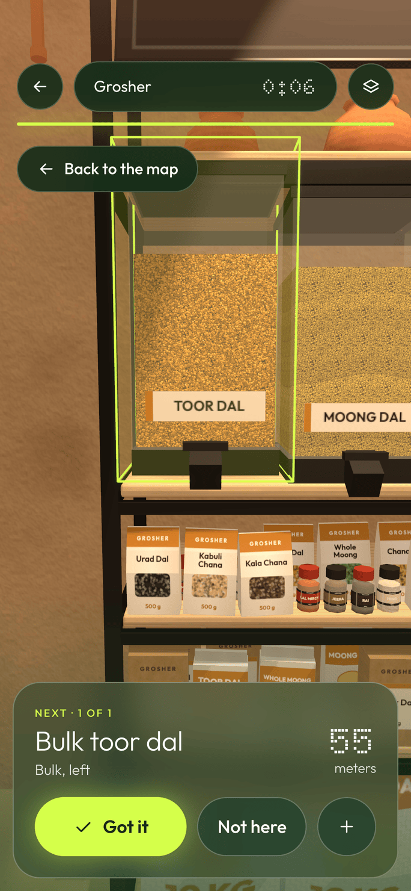
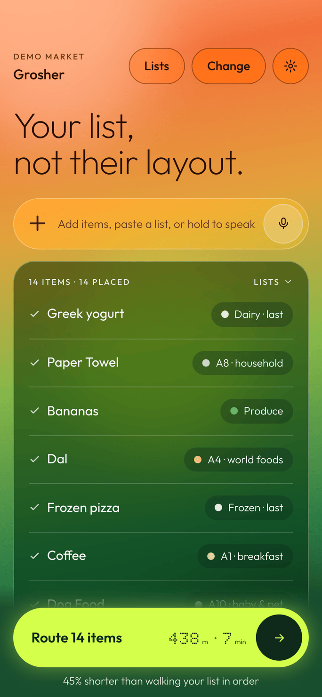
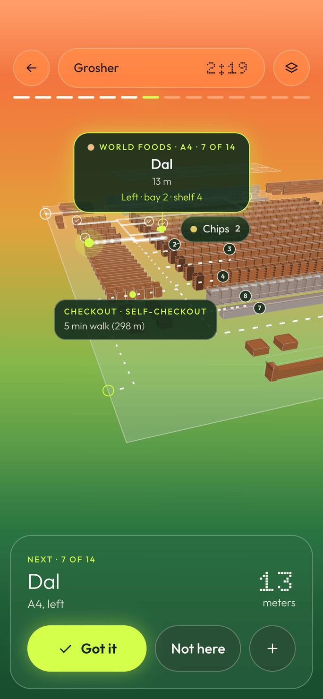
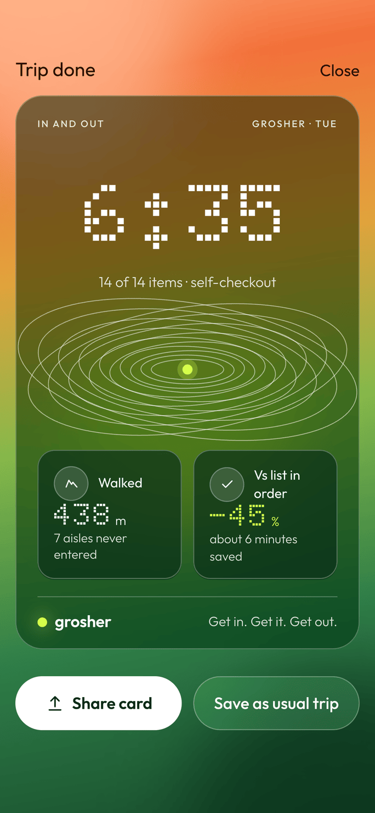
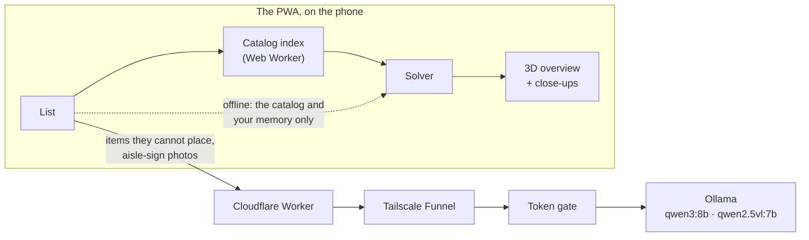
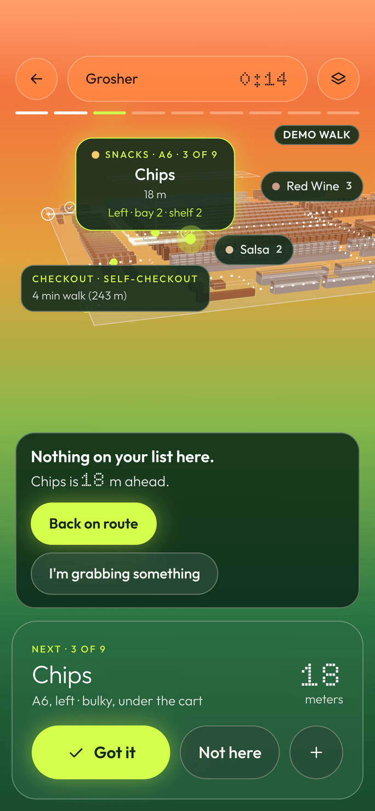
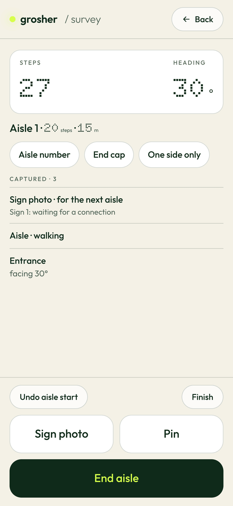

# Grosher

[](https://github.com/atishaypahadiya/Grosher/actions/workflows/ci.yml)

**[Read the project write-up](https://grosher.pages.dev/project/)** · [Open the app](https://grosher.pages.dev)

A shopping list in, the shortest walk through the store out: every item placed on its shelf, the route
re-solved each time you check one off, and every stop opening at eye level when you get there.

<!-- the hero: an inline MP4 once uploaded through GitHub (a user-attachments URL), with this 2× still as the fallback -->
<p align="center">
  <a href="apps/web/public/project/img/closeup.mp4"></a>
</p>
<p align="center"><sub>The app as built, at a stop in Bulk: tap it for the video (60 fps, from Produce's skylight to this bin). Captured on the GPU from the production build by <code>apps/web/scripts/capture-closeup.mjs</code>.</sub></p>

<p>
  
  
  
</p>
<p><sub>List, trip and checkout for one 14-item list (<code>apps/web/scripts/capture-project.mjs</code>, 20 Oct 2026). The design boards these started from are in <a href="design/boards/">design/boards/</a>; <a href="DESIGN.md">DESIGN.md</a> is the visual contract.</sub></p>

## Who it's for

Only what the app does today is listed under "Today"; "Next" is not built yet.

- **Delivery shoppers.** Someone else's list in a store they may not know. *Today:* the whole list as one
  route, re-solved after every Got it, cold and hot items last, Not here to move on. *Next:* a shopper mode
  (several orders in one walk, items tagged per order, bag sorting, substitutions).
- **Blind and low-vision shoppers.** Signs and shelf tags they cannot read. *Today:* the list by voice in Safari,
  and every screen contrast-checked on every change. *Next:* an accessibility mode (spoken turn-by-turn
  directions, full VoiceOver support, a large-type view, audio arrival cues), designed and tested with blind users.
- **Huge stores.** Thirty items picked in written order is a long walk. *Today:* a 30-stop list solved in
  ~<!--n:bench.30.p50ms-->18<!--/n--> ms (the median on an M4 Pro), <!--n:bench.30.savedPct-->57<!--/n-->% less walking than the list's order. *Next:* stores on several floors and
  warehouse-style layouts.

## What it does



### The list and the resolver

- **Type, paste or hold to speak.** Voice uses the Web Speech API: release to stop, and each pause becomes an
  item. In the app installed on an iPhone's home screen the mic is hidden, because WebKit's recogniser has been
  reported not to start there (not yet checked on a device). The list says "Voice works in Safari, or use the
  keyboard mic." and offers **Try it here**, which shows the mic on that phone from then on; the keyboard's own
  dictation works everywhere. Lists save, the usual trip for today's weekday is offered when the list is empty, and every trip goes
  into a history.
- **Every line is placed on a shelf, in seven layers.** In order: an exact catalog name or brand, your own
  memory of where you found it, a shelf category that names it ("atta", "tp"), a fuzzy match for typos
  (trigram Dice and Damerau–Levenshtein, threshold .72), a near spelling of a category, the language model,
  and finally a question for you ("Needs a place · Tell me where"). Every answer is checked against the map
  before it is used, so a stale location never reaches the solver.
- **A 47,612-item catalog.** It is built from the Instacart 2017 product list (44,531 rows, used under
  non-commercial terms; see `packages/stores/data/instacart/README.md`), 3,051 rows generated by a local
  model, and 30 hand-kept rows. A reconcile pass checks it shelf by shelf. The index is built in a Web Worker
  and cached in IndexedDB.
- **A local model for the rest.** `qwen3:8b` runs in Ollama on my Mac and picks one of the store's shelf
  categories, or none. One call covers the whole list, with strict JSON out. It is reached through a Cloudflare
  Worker, Tailscale Funnel and a token gate. No key ships in the app, and a test builds the bundle and searches
  it to make sure.
- **Honest about guesses.** Every placement carries a confidence: confirmed (≥ .8), likely (.5–.8) or guess
  (< .5). A model's answer starts in the guess band and shows in amber as "probably A4 · cereal". Got it moves
  a placement 30% of the way to certain, Not here takes .3 off, and anything unconfirmed for 90 days decays.
- **It learns the store.** A shelf you confirmed beats the catalog for that item. What you typed comes back as
  a suggestion ("yogurt" → "Chobani greek yogurt?"). Three misses in one aisle, or a quarter of a trip, flag
  the store as possibly reset and open that aisle in the editor.

### Cook mode

- **Dishes in, a list out.** "Plan meals" takes dishes ("dal chawal, rajma, poha, pasta arrabbiata") and how
  many people are eating. A review sheet shows each dish's ingredients, then one merged list in what the store
  sells: "Onions × 4", "Toor dal 500 g", "Paneer 2 × 400 g". Every line says which dishes it is for, and you can
  edit or remove it. Salt, oil and the everyday spices sit under "You probably have", unticked. Nothing reaches
  your list until you tap Add, and then the resolver places it and Route works as usual.
- **A dish table first.** 110 dishes, 64 of them Indian home staples, each written by hand for two servings
  with its core ingredients, scaled by the number of people and rounded up to whole packs once, after the
  merge. A test checks that every dish lists its core ingredients, that no quantity is out of bounds, and that
  every ingredient line lands on a Grosher shelf without the model.
- **The local model for the rest, never a cloud one.** A dish the table does not know goes to `qwen3:8b` on the
  Mac, one call a dish, with a strict JSON schema. Its answer is validated (a line with no usable unit is
  dropped, a quantity past its category's bound is capped, and the sheet says which), cached on the device,
  and tagged "estimated" in amber. When the Mac is asleep, the table's dishes still work and the others say
  they need the laptop's model.
- **How good the model is** (20 Oct 2026, ten dishes not in the table, recorded so CI scores it without a
  model): 29 of 37 core ingredients named, about 10 s a dish on an M-series Mac. Carbonara, stroganoff,
  ratatouille, jambalaya and moussaka come back complete. It made rogan josh with chicken and coconut milk, and
  sarson ka saag without spinach or makki atta. Those misses are why the table comes first and why every model
  line is marked as an estimate; both dishes, with malai kofta, dhokla and 18 more, are in the table now.

### The route

- **Exact up to 13 stops.** `packages/core` (no dependencies) runs Dijkstra over a graph of corridors in metres,
  then Held–Karp over the stops, the candidate shelves of multi-location items and the checkout lanes. Above 13
  stops it runs 2-opt and Or-opt from three starts, with delta evaluation.
- **The constraints a person applies anyway.** They are penalties in metres, so they trade against distance
  instead of overriding it:
  - cold *and* hot last (chilled, frozen, the rotisserie and the hot bar), taken from the shelf's storage;
  - heavy early (by the shelf: cases of water, gallon jugs, big rice bags), so it goes in the cart first;
  - fragile late;
  - produce before the fragile things;
  - bulky (paper towels, chips) rides under the cart and costs nothing.
- **Re-solved at every check-off.** Got it, Not here and adding an item re-plan the remaining stops from the
  shelf you are standing at. An item the map cannot place is left out of the route and asked about at checkout.

### The store: Grosher

The app opens **Grosher**, our own designed Whole Foods-style market (85 × 70 m, spec in
[design/store-grosher.md](design/store-grosher.md)). It has produce under a skylight, bulk, ten centre aisles,
beer and wine, service counters and dairy on the east wall, frozen, a food hall, pharmacy and body care. That
comes to 325 shelf categories the way the signs read, 123 fixtures and eight staffed lanes plus express and
self-checkout. Four hero lists ship with it. A synthetic Walmart-style Supercenter (30 aisles, 298 categories)
is kept for the tests and as the reference taxonomy that survey mode matches Walmart signs against.

### On the trip

- **A 3D map of the store.** It frames the current leg, lights the exact bay and shelf of the next item, and
  shows cards for the next stop and the two after it, with chips on the edge for stops off screen.
- **Every stop at eye level.** When a stop becomes next, the camera comes down to the aisle and walks you to
  the shelf.
  - **Bulk** and **Produce** are hero zones, drawn from recipes with a procedural shelf kit: clay walls,
    gravity bins with grain at real size, burlap sacks and a stone chakki in Bulk; crates under a skylight, its
    wet wall and juice line in Produce.
  - The other 304 shelves get **standard close-ups** generated from the store data.
  - The next close-up is prepared while you are at the current stop, so it opens without a wait, and only
    one zone's textures are on the GPU at a time.
- **The off-list guard.** When you clearly drift off the route, a small card says "Nothing on your list here.
  Chips is 18 m ahead." with **Back on route** · I'm grabbing something.
  - It works from your steps (the phone's accelerometer) against the leg's length, with nothing more precise:
    there is no indoor positioning.
  - Arriving at the stop and staying there gets "Can't find Chips?" instead.
  - It never speaks in the first minute, during a close-up's arrival, in a queue, or while you wait at a
    counter.
  - Off · Gentle · Strict are in Settings. Motion data stays on the phone and only this trip's counts are
    kept.
  - `?demo=walk` plays it on a desk.

  
- **Checkout.** A share card shows the time, the metres walked and the saving against walking the list in
  order, plus "1 detour · off-route 1 min" when the guard spoke. A "Make the map better" list asks about
  what was skipped or never placed.

### Mapping a real store

- **One walk, in survey mode** (`#/survey` on the phone). Calibrate once by walking 10 m. Then, per aisle:
  Sign photo → Start → walk → End. Steps come from the accelerometer and directions from the compass; on the 8
  held-out synthetic walks, the step detector counts 156 of 160 steps. The aisle signs are read in the
  background by a vision model (`qwen2.5vl:7b`) and matched to shelf categories. "Build draft map" gives aisles
  at their lengths and spacing, with the signs' categories on them.

  
- **The editor** (`#/edit`, desktop) fixes the draft. It has a floor-plan underlay, corridors, doors, shelf
  blocks, locations, categories, textures, a confidence view, and Validate. "Write to package" writes it into
  `packages/stores/<storeId>`. The step-by-step guide is in `CLAUDE.md`, "How to map a new store".

### Offline, and never a blank screen

It is a PWA that installs to the home screen. After one visit the app, the map, the catalog and its index are
on the phone, and a trip needs no network. Saved state is versioned and validated, and a bad value is set aside
rather than read. Navigations are network-first, so a deploy reaches an installed app on its next open. An
inline boot guard shows an error plate with Reload and Reset (which exports your lists first) instead of a blank
page.

## Numbers

Every number below that a gate or a test measures is checked against it on every push
(`apps/web/scripts/docs-numbers.mjs`, after the gates in CI): if the code moves a number and this page does
not, CI fails. Timings vary run to run, so they are not checked; they carry their date and machine instead.

**Route vs walking the list as written**, Grosher's four hero lists (`packages/stores/test/grosher.test.ts`
and its snapshot `test/fixtures/grosher-hero-routes.json`; walking distance only, every item placed offline,
exact by Held–Karp):

| list | items | in order | Grosher | saved |
| --- | ---: | ---: | ---: | ---: |
| Weeknight dal-chawal | 10 | <!--n:routes.dal-chawal.listOrderM-->440<!--/n--> m | <!--n:routes.dal-chawal.routeM-->315<!--/n--> m | <!--n:routes.dal-chawal.savedPct-->28<!--/n-->% |
| Weekly staples | 11 | <!--n:routes.weekly-staples.listOrderM-->513<!--/n--> m | <!--n:routes.weekly-staples.routeM-->359<!--/n--> m | <!--n:routes.weekly-staples.savedPct-->30<!--/n-->% |
| Friday night in | 9 | <!--n:routes.friday-night.listOrderM-->523<!--/n--> m | <!--n:routes.friday-night.routeM-->289<!--/n--> m | <!--n:routes.friday-night.savedPct-->45<!--/n-->% |
| Pharmacy run | 5 | <!--n:routes.pharmacy-run.listOrderM-->331<!--/n--> m | <!--n:routes.pharmacy-run.routeM-->256<!--/n--> m | <!--n:routes.pharmacy-run.savedPct-->22<!--/n-->% |

**Random lists** (`npm run bench -- --store grosher`: 30 random lists per size from 30 everyday items,
walking distance only; solve times measured 20 Oct 2026 on an M4 Pro, not checked):

| stops | solver | list order | Grosher | saved | saved p10–p90 | solve p50 | solve max |
| ---: | --- | ---: | ---: | ---: | ---: | ---: | ---: |
| 5 | Held–Karp | <!--n:bench.5.listOrderM-->339<!--/n--> m | <!--n:bench.5.routeM-->252<!--/n--> m | <!--n:bench.5.savedPct-->25<!--/n-->% | <!--n:bench.5.p10-->9<!--/n-->–<!--n:bench.5.p90-->40<!--/n-->% | 0.0 ms | 0.2 ms |
| 8 | Held–Karp | <!--n:bench.8.listOrderM-->472<!--/n--> m | <!--n:bench.8.routeM-->305<!--/n--> m | <!--n:bench.8.savedPct-->35<!--/n-->% | <!--n:bench.8.p10-->24<!--/n-->–<!--n:bench.8.p90-->42<!--/n-->% | 0.1 ms | 0.1 ms |
| 10 | Held–Karp | <!--n:bench.10.listOrderM-->577<!--/n--> m | <!--n:bench.10.routeM-->343<!--/n--> m | <!--n:bench.10.savedPct-->41<!--/n-->% | <!--n:bench.10.p10-->28<!--/n-->–<!--n:bench.10.p90-->49<!--/n-->% | 0.4 ms | 1.2 ms |
| 13 | Held–Karp | <!--n:bench.13.listOrderM-->704<!--/n--> m | <!--n:bench.13.routeM-->391<!--/n--> m | <!--n:bench.13.savedPct-->44<!--/n-->% | <!--n:bench.13.p10-->36<!--/n-->–<!--n:bench.13.p90-->51<!--/n-->% | 4.5 ms | 4.9 ms |
| 18 | heuristic | <!--n:bench.18.listOrderM-->977<!--/n--> m | <!--n:bench.18.routeM-->511<!--/n--> m | <!--n:bench.18.savedPct-->48<!--/n-->% | <!--n:bench.18.p10-->44<!--/n-->–<!--n:bench.18.p90-->54<!--/n-->% | 4.1 ms | 9.1 ms |
| 25 | heuristic | <!--n:bench.25.listOrderM-->1,270<!--/n--> m | <!--n:bench.25.routeM-->614<!--/n--> m | <!--n:bench.25.savedPct-->52<!--/n-->% | <!--n:bench.25.p10-->50<!--/n-->–<!--n:bench.25.p90-->55<!--/n-->% | 8.5 ms | 9.5 ms |
| 30 | heuristic | <!--n:bench.30.listOrderM-->1,532<!--/n--> m | <!--n:bench.30.routeM-->665<!--/n--> m | <!--n:bench.30.savedPct-->57<!--/n-->% | <!--n:bench.30.p10-->53<!--/n-->–<!--n:bench.30.p90-->59<!--/n-->% | 18.1 ms | 19.8 ms |

**Item resolution** (`npm run eval:everyday -w @grosher/stores -- --store grosher`, scored at aisle level; the
model's column was measured 20 Oct 2026 with qwen3:8b on the Mac, which CI does not have):

| set | without the model | with qwen3:8b |
| --- | ---: | ---: |
| 150 everyday items, written blind (food, brands, household, pharmacy, Indian staples, misspellings) | <!--n:eval.grosher.correct-->149<!--/n--> / <!--n:eval.grosher.total-->150<!--/n--> (<!--n:eval.grosher.pct-->99<!--/n-->%) | 149 / 150 |
| the same set on the demo Supercenter | <!--n:eval.demo.correct-->147<!--/n--> / 150 (<!--n:eval.demo.pct-->98<!--/n-->%) | – |
| 33 things Walmart grocery had no shelf for (beer and wine, bulk, cookware, flowers, the food hall; not blind) | <!--n:eval.newShelves.grosher-->29<!--/n--> / 33 | 32 / 33 |

The one miss on Grosher is "salmon fillet", which lands on frozen fillets rather than the seafood counter.
The two tuned regression fixtures (`packages/core/test/fixtures`, 60 and 30 items) are 100%.

**The 3D view**, against the budgets in DESIGN.md §3, as CI measures it (headless Chromium, SwiftShader,
390 × 844):

| check | measured | budget |
| --- | --- | --- |
| overview, worst of three framings (`scripts/perf-gate.mjs`) | <!--n:perf.calls-->48<!--/n--> draw calls, <!--n:perf.instances-->7,924<!--/n--> product instances | ≤ 70 calls, ≤ 12,000 instances |
| close-ups, worst arrival frame (`scripts/hero-gate.mjs`) | Bulk <!--n:closeup.bulk.calls-->61<!--/n--> calls / <!--n:closeup.bulk.triangles-->205k<!--/n--> triangles; Produce <!--n:closeup.produce.calls-->54<!--/n--> / <!--n:closeup.produce.triangles-->169k<!--/n-->; standard A4-R16 <!--n:closeup.standard.calls-->46<!--/n--> / <!--n:closeup.standard.triangles-->179k<!--/n--> | ≤ 70 calls, ≤ 250k triangles |
| close-up GPU textures, peak across four close-ups in a row | <!--n:closeup.peakMB-->13.7<!--/n--> MB | ≤ 16 MB |
| close-up download | Bulk <!--n:closeup.download.bulk-->2,306<!--/n--> KB · standard <!--n:closeup.download.standard-->1,527<!--/n--> KB · Produce <!--n:closeup.download.produce-->1,476<!--/n--> KB | ≤ 2,500 KB |
| next close-up, prepared during the stop before: asked for → ready | within the limit at every hand-over | ≤ 2 frames or 400 ms |

Frame times under SwiftShader are software rendering, so no frame rate is claimed for a phone.

**Loading** (production build, headless Chromium at 390 × 844, median of 3, 20 Oct 2026, not checked): the list
is interactive at 80 ms cold and 76 ms warm. The 145,964-form catalog index is ready at 1,104 ms cold (built in
the worker) and 147 ms warm (from IndexedDB).

## Quality gates

Every push to `main` runs `.github/workflows/ci.yml`:

| gate | what fails it |
| --- | --- |
| typecheck | `tsc --noEmit` in every workspace |
| tests | the engine, store data, worker and web app suites (`npm test`) |
| no key in the bundle | `apps/web/test/bundle.test.ts` builds the app and searches it for an Anthropic key prefix |
| perf gate | the overview over 70 draw calls or 12,000 instances in any of three framings |
| close-up gate | any close-up over its call, triangle, GPU-texture or download budget; a close-up fetched when it should not be; a next stop not prepared ahead |
| contrast gate | text under 4.5:1, or an icon or focus ring under 3:1, against the pixels actually behind it, on every screen including the 3D scene and the project page |
| survey flow | survey mode end to end with mocked sensors: calibrate, three aisles, offline sign photos, build, export, import |
| cook mode | dishes → review → list → route with the model mocked: the table's lines, the model's dish tagged, pantry unticked, edits kept; the Mac asleep; the cache |
| guard demo | the off-list guard firing anywhere but the demo's one detour, or speaking during a counter wait |
| boot resilience | a stale service worker, old saved state, missing chunks or a render error leaving a blank screen |
| docs numbers | a number in this README or on the project page that the gates above did not measure |

## Run it

Node 22.18 or newer.

```bash
npm install
npm run dev                          # http://localhost:5173, also on the LAN for a phone
npm test                             # engine, store data, worker, web app
npm run bench -- --store grosher     # the random-list table above
```

For the model layer, install [Ollama](https://ollama.com) and run `ollama pull qwen3:8b`. On the Mac, the dev
server talks to it at `http://localhost:11434`. Ollama listens on loopback only, so a phone goes through the
Cloudflare Worker in `apps/resolver`, which reaches the same model through Tailscale Funnel and a token gate.
Without any of it the app still works: items the catalog and your memory cannot place ask for one tap.

## Operations

The model layer runs on one Mac. The chain is: the installed app → the Cloudflare Worker → a Tailscale Funnel
address (a fixed public HTTPS name on the tailnet) → a small token gate on `127.0.0.1:11435` → Ollama on
`127.0.0.1:11434`.

- **One command checks it:** `npm run chain:status -w @grosher/resolver` prints one ✓ or ✗ line per link, with
  the fix for each ✗, and exits 1 on any failure. The links are Ollama, the model loaded, the gate, the Funnel
  (a public request without the token must get 401) and the Worker's `/health`.
- **It comes back after a reboot by itself.** Two LaunchAgents start at login:
  - `dev.grosher.ollama` sets Ollama's environment and opens the app, then warms `qwen3:8b` with a one-token
    request.
  - `dev.grosher.gate` keeps the gate running, restarting it within a second if it dies.

  The Funnel is stored in Tailscale's own config, so it returns with the Tailscale app.
  `npm run chain:install -w @grosher/resolver` installs both agents; `--uninstall` removes them.
- **Ollama listens on loopback only** (`OLLAMA_HOST=127.0.0.1`). It has no authentication, so nothing on the
  LAN or the tailnet can reach it: the gate is its one client, and only the gate is on the Funnel. The gate
  passes two routes, and only with the exact bearer token. The Ollama app's "Expose Ollama to the network"
  setting must stay off, because it overrides that; `chain:status` fails if anything listens beyond loopback.
- **Two models can stay resident** (`OLLAMA_MAX_LOADED_MODELS=2`, `OLLAMA_KEEP_ALIVE=24h`): `qwen3:8b` for the
  list (6.1 GB loaded) and `qwen2.5vl:7b` for survey mode's sign photos (8.0 GB). The vision model loads on the
  first sign read, and from then on both fit together (14.1 GB within the 24 GB Mac's 17.8 GiB GPU budget), so a sign
  read never evicts the list's model. A third model loaded by anything else would evict one of them.
- **When the Mac sleeps**, the Worker answers every item as unknown with `degraded: true`. The app shows
  "Resolver offline · unknown items need a tap", and everything the catalog and memory can place still works.
- **Secrets stay in the Worker.** The Funnel address and the token are Worker secrets, and the token file on the
  Mac is readable by its owner only. Nothing secret ships in the app (the bundle test checks).

The one-time setup (the token, Funnel, the agents, `wrangler secret put`, deploy) is in `CLAUDE.md`, under
"Worker deploy".

## Layout

```
packages/core     routing engine + item resolution
                  (no dependencies; Node runs the TypeScript)
packages/stores   store data: Grosher (the default), the synthetic
                  Supercenter (tests, Walmart reference), generators
apps/web          Vite + React 19 PWA: list, 3D trip with close-ups,
                  checkout, editor, survey mode
apps/resolver     Cloudflare Worker (Hono): the model layer and
                  the sign reader over HTTPS
```

`CLAUDE.md` is the full project guide. `DESIGN.md` holds the design rules and tokens.

## Data and terms

The product names come from **The Instacart Online Grocery Shopping Dataset 2017**, used under its
non-commercial terms with attribution (`packages/stores/data/instacart/README.md`). Anything commercial must
replace it. The store layouts, the taxonomy, the textures and the generated rows are ours. Fonts: Outfit and
Doto, SIL Open Font License.
