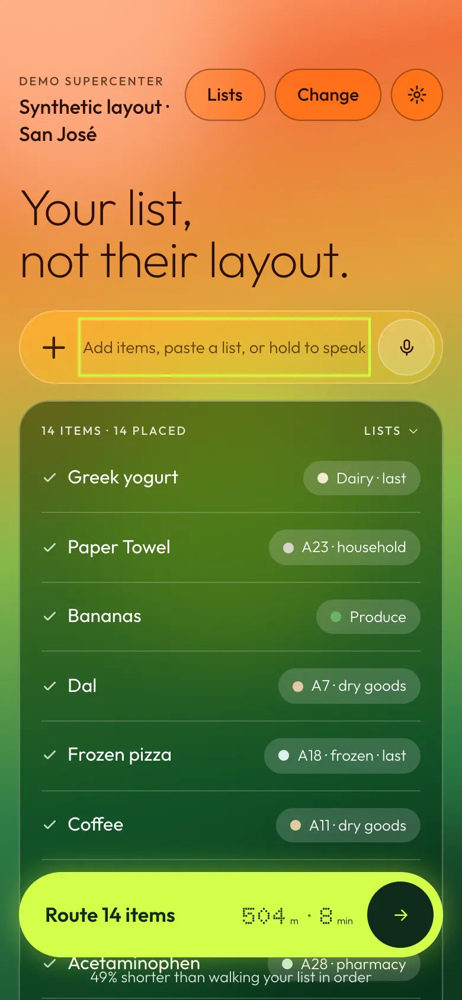
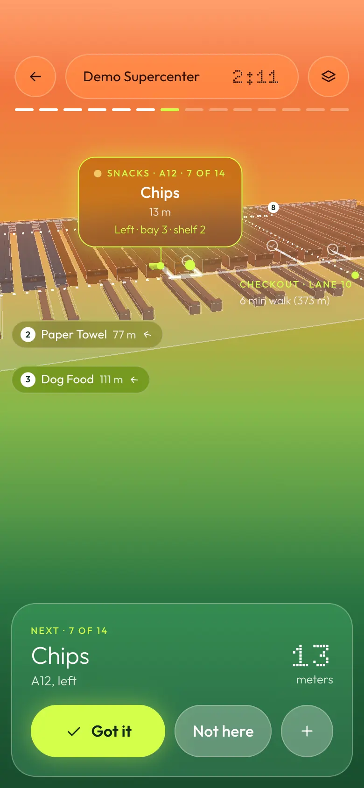
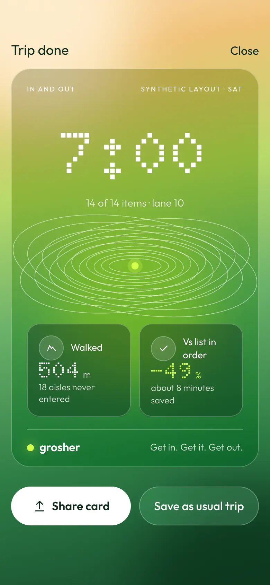

# Grosher

[](https://github.com/atishaypahadiya/Grosher/actions/workflows/ci.yml)

**[Read the project write-up](https://grosher.pages.dev/project/)** · [Open the app](https://grosher.pages.dev)

Grosher turns a shopping list into the shortest walk through the store. Type, paste or dictate the list; each
line is matched to a shelf (the store's catalog first, then your own memory of where things were, then a local
language model for the rest); the route is solved exactly for up to 13 stops with the shopping constraints a
person would apply anyway (frozen last, heavy late, eggs and chips after the cans), and it re-plans from where
you stand every time you check something off. One synthetic 30-aisle Supercenter ships as the demo, with 298
shelf categories the way the aisle signs read and a 47,000-item catalog built from the Instacart 2017 product
list (non-commercial terms, see `packages/stores/data/instacart/README.md`), so most everyday items resolve
to the right aisle without a survey; real stores are surveyed with the built-in map editor. It is a web app that installs to the home screen and works offline.
The visual contract is [DESIGN.md](DESIGN.md).

<p>
  
  
  
</p>
<p><sub>Screenshots of the app as built (<code>apps/web/scripts/capture-project.mjs</code> keeps them current). The original design boards are in <a href="design/boards/">design/boards/</a>.</sub>
</p>

## The route

`packages/core` is a zero-dependency routing engine: the store is a graph of corridors in metres with shelf
locations pinned to edges, Dijkstra over it, then Held–Karp (exact, with penalties and multi-location items) up
to 13 stops and a greedy + 2-opt + Or-opt heuristic above that. `npm run bench` against the demo store, random
lists, walking distance only:

| stops | solver | list order | Grosher | saved | solve p50 |
| ---: | --- | ---: | ---: | ---: | ---: |
| 5 | Held–Karp | 391 m | 314 m | 20% | 0.0 ms |
| 8 | Held–Karp | 594 m | 388 m | 35% | 0.1 ms |
| 10 | Held–Karp | 666 m | 431 m | 35% | 0.4 ms |
| 13 | Held–Karp | 868 m | 485 m | 44% | 4.6 ms |
| 18 | heuristic | 1,171 m | 584 m | 50% | 3.6 ms |
| 25 | heuristic | 1,540 m | 722 m | 53% | 8.0 ms |
| 30 | heuristic | 1,834 m | 786 m | 57% | 17.7 ms |

## Item resolution

A typed line becomes a stop through five layers in order: exact catalog match (names, brands, quantities
stripped), fuzzy match (trigram Dice + Damerau–Levenshtein, threshold .72), the shopper's own per-store memory,
a local language model (Ollama, `qwen3:8b`, one call per list, strict JSON, about 27 output tokens per item) that
names the department, and finally "unknown", which asks for a tap on the map. Two fixtures in
`packages/core/test/fixtures`: a tuned set the thresholds were set on, and a held-out set written blind
afterwards that is only ever reported.

| layer | tuned set (60) | held-out set (30) |
| --- | ---: | ---: |
| exact | 20 / 20 | 8 / 8 |
| fuzzy | 12 / 12 | 8 / 8 |
| memory | 8 / 8 | 6 / 6 |
| llm | 12 / 12 | 6 / 6 |
| unknown | 8 / 8 | 2 / 2 |
| all | 100% | 100% |

A third fixture, 150 everyday items written blind (food, household, pharmacy, Indian staples, brands,
misspellings), scores **98% at aisle level without the model** on the demo store.

What you confirm on a trip is remembered: "Got it" raises confidence, "Not here" lowers it, a tap on the map
places it, and the exact words you typed come back as a suggestion next time ("yogurt" → "Chobani greek
yogurt?").

## Run it

Node 22.18 or newer.

```bash
npm install
npm run dev                 # http://localhost:5173, also on the LAN for a phone
npm test                    # engine, store data, worker, web app
npm run bench               # the table above
```

For the language-model layer, install [Ollama](https://ollama.com), `ollama pull qwen3:8b`, and start it with
`OLLAMA_ORIGINS` allowing the app's origin. The phone uses the Mac's address from `apps/web/.env.local`
(`VITE_OLLAMA_URL=http://192.168.1.20:11434`) while on the same Wi-Fi, or, installed, the Cloudflare worker in
`apps/resolver` that reaches the same model through Tailscale Funnel and a token gate (setup and the
LaunchAgents that keep it up across reboots: `apps/resolver/README.md`, `npm run chain:status -w @grosher/resolver`). Without any of it the app still works: items the
catalog and your memory cannot place ask for one tap.

## Map a store

**One walk:** open `#/survey` on the phone. Calibrate once ("Walk 10 m"), then in the store tap Entrance and,
per aisle, Sign photo → Start → walk → End; pin the landmarks (dairy wall, checkout lanes, exit). Steps come from
the accelerometer, directions from the compass, and the aisle signs are read by a vision model on the Mac
(`ollama pull qwen2.5vl:7b`) in the background. "Build draft map" gives aisles at their lengths and spacing, the
signs' categories on them, and the doors; AirDrop the survey file to the Mac and fix the draft in the editor.

**By hand:** open `#/edit` on a desktop. Add a floor-plan photo as the underlay and scale it to a known distance; tap along
each walkable corridor (taps snap, loops close); mark the entrance, exit and checkout lanes; draw the shelf
blocks and give each a department and an aisle sign; drop locations on the corridor beside the shelves and list
the items that live there; one straight-on photo per department for the 3D textures; Validate until it is clean;
"Write to package" into `packages/stores/<storeId>`. The step-by-step version is in `CLAUDE.md` under "How to
map a new store".

## Layout

```
packages/core      routing engine + item resolution (no dependencies, Node runs the TypeScript)
packages/stores    store data: the demo Supercenter, departments, shelf slots, generators
apps/web           Vite + React PWA: list, 3D trip, checkout, editor
apps/resolver      Cloudflare Worker: the language-model layer over HTTPS
```

`CLAUDE.md` is the full project guide; `DESIGN.md` the design rules and tokens.
